<div align="center">

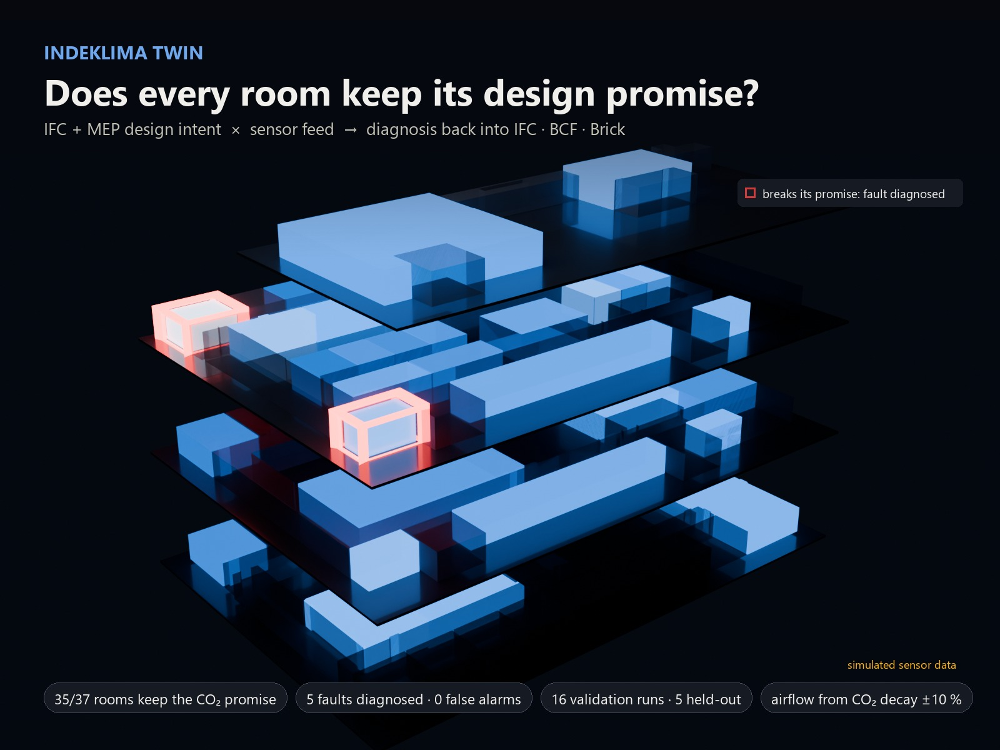

# Indeklima Twin

### Every room in a building is designed with a promise. Indeklima Twin checks whether it keeps it.

**[▶ Live site + interactive 3D twin](https://abdullah13793-commits.github.io/indeklima-twin/)** · **[60-second film](https://abdullah13793-commits.github.io/indeklima-twin/#film)** · **[PDF report](reports/Indeklima_Twin_Building308_report.pdf)**

       

</div>

> **Simulated sensor data.** The feed comes from a physics model with planted faults, so every diagnosis can be scored
> against ground truth. The pipeline reads MQTT / JSONL / CSV and takes a real feed unchanged.

---

## What it does

The MEP engineer designed every room for a number of people and an outdoor-air rate. That gives each room a
**design promise**: the CO₂ level and comfort category it should never leave. After handover, nobody checks it.
Sensors are compared with generic thresholds ("CO₂ above 1,000 ppm"), so a 15-person meeting room and a corridor
are judged by the same line.

Indeklima Twin connects the two things the building already has:

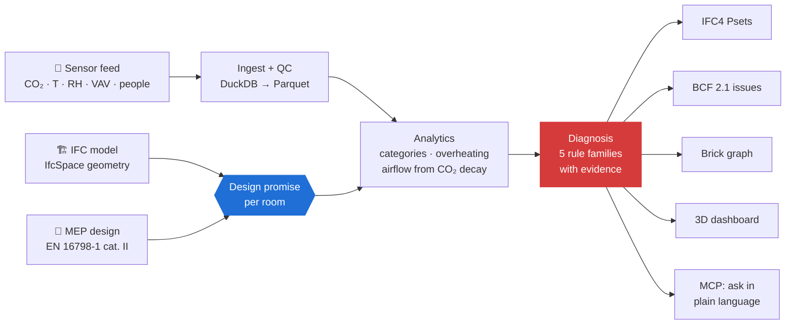

<p align="center">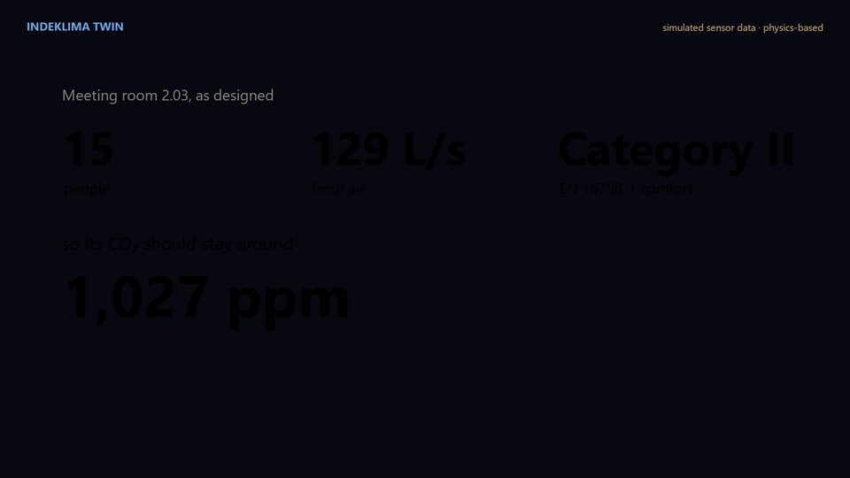</p>

## The live twin

The 3D dashboard is built straight from the IFC spaces: exploded storeys, rooms coloured by CO₂, temperature,
airflow-vs-design or occupancy, a time slider over two weeks, and a promise card for every room.

<p align="center">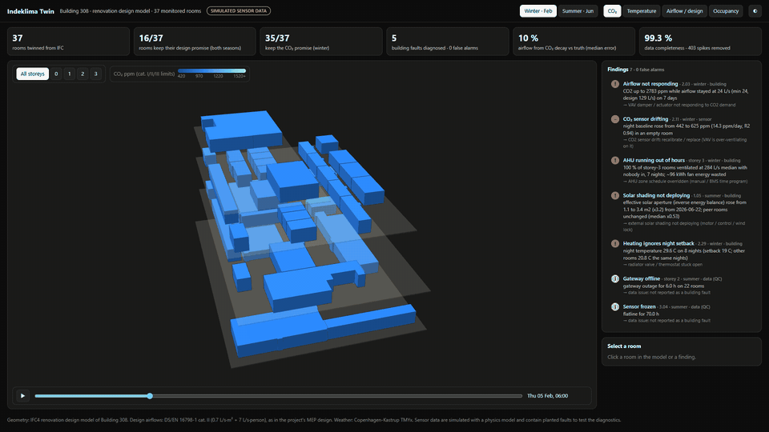</p>

| CO₂ against the promise | Summer temperature | One storey, one room |
|---|---|---|
| 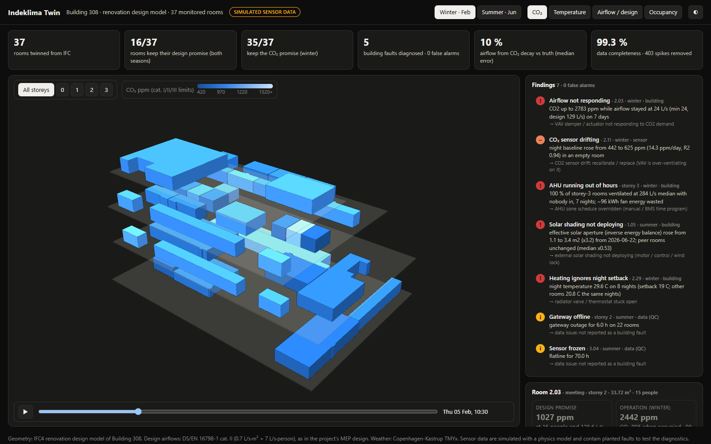 | 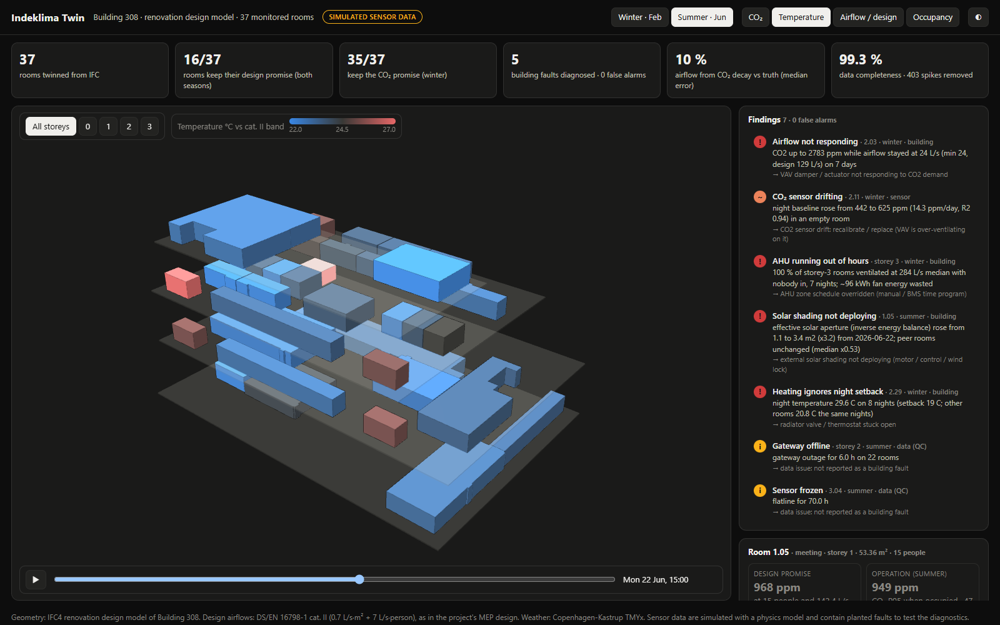 | 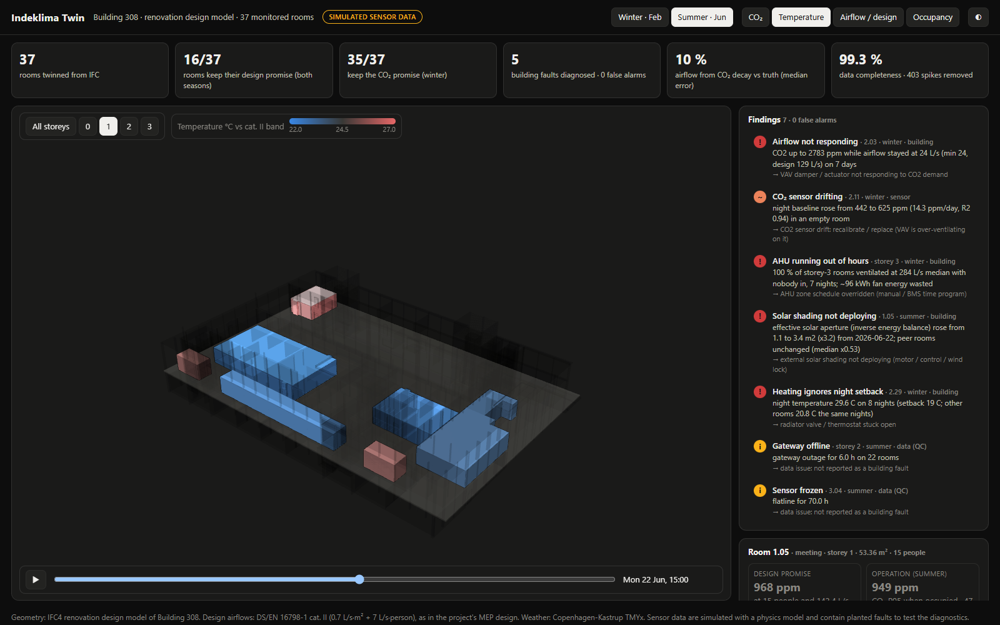 |

**[Open the interactive twin →](https://abdullah13793-commits.github.io/indeklima-twin/twin/)**

## Promise vs reality

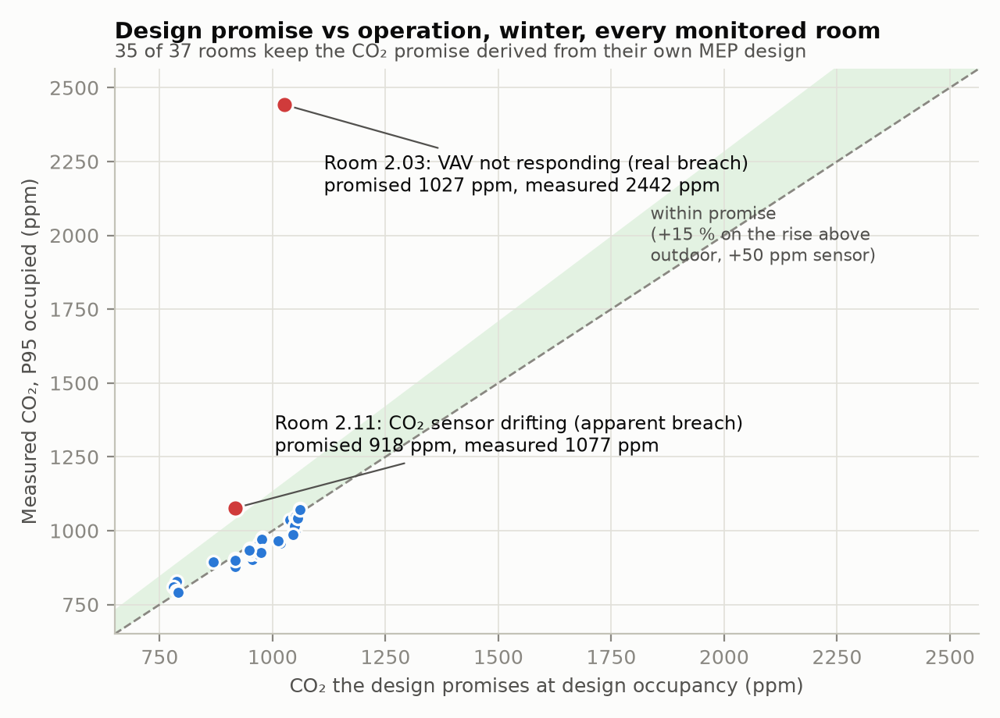

35 of 37 rooms keep the winter CO₂ promise. The two that don't break it for very different reasons. Room 2.03 is
really under-ventilated: its VAV damper is stuck. Room 2.11 only *looks* like it: its CO₂ sensor is drifting, and the
VAV is over-ventilating on the false reading. A fixed-threshold alarm can't tell them apart. The twin can.

## Diagnoses, not alarms

| Rule | Finds | Evidence it shows |
|---|---|---|
| **R1** | VAV damper / actuator not responding | CO₂ far above the promise while airflow sits at minimum |
| **R2** | CO₂ sensor drift | empty-room night baseline rising day by day while storey peers stay at outdoor level |
| **R3** | AHU zone running out of hours | rooms of a storey ventilated at night with nobody in; wasted fan kWh (summer night cooling excluded) |
| **R4** | Solar shading not deploying | inverse energy balance: the room's effective solar aperture triples while its peers stay flat |
| **R5** | Heating ignores night setback | room stays far warmer than the other rooms on the same nights |
| **QC** | frozen sensor, gateway outage, spikes, gaps | reported as data issues, never as building faults |

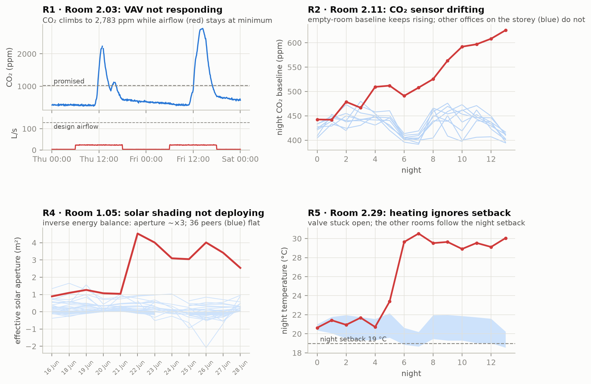

<table><tr>
<td width="50%">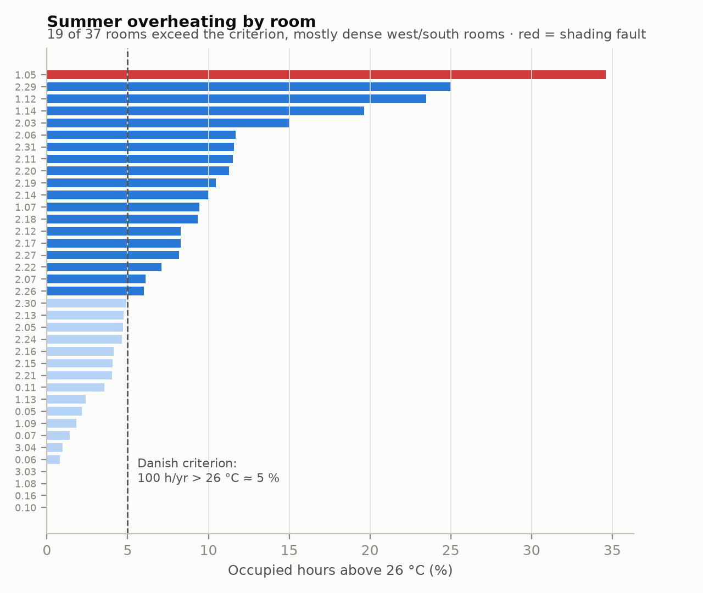</td>
<td width="50%">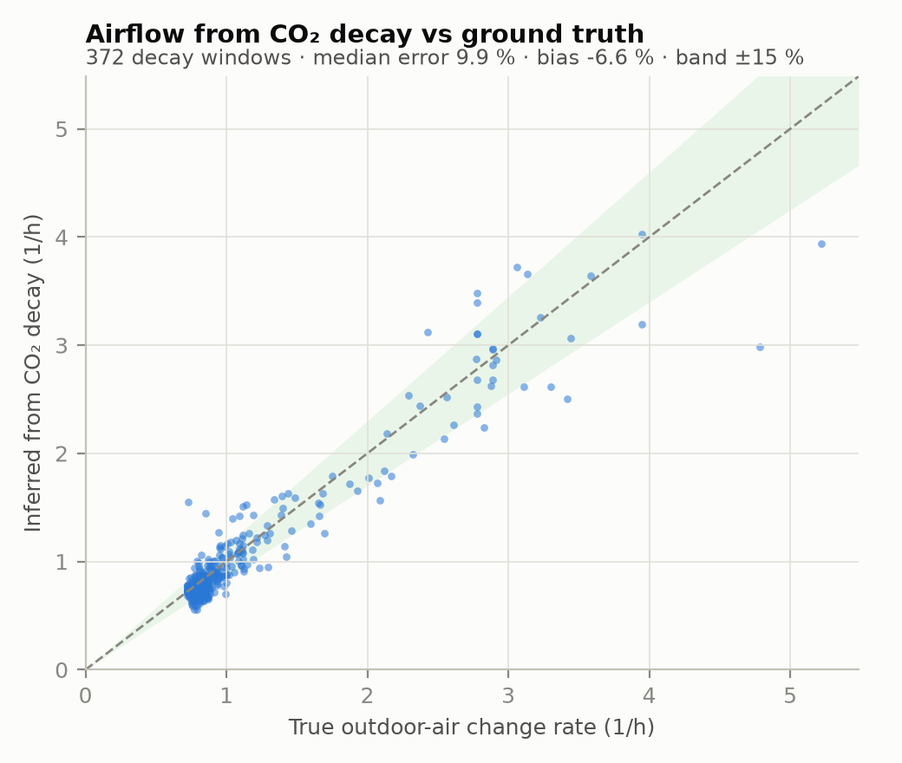</td>
</tr><tr>
<td>Summer overheating per room against the Danish practice limit. Red = the room whose shading failed.</td>
<td>Outdoor airflow recovered from CO₂ decay, checked against the true airflow: median error 9.9 % over 372 windows.</td>
</tr></table>

## Ask your building (MCP)

`src/mcp_server.py` is a [Model Context Protocol](https://modelcontextprotocol.io) server. Any MCP client
(Claude, Copilot, IDE agents) can query the twin in plain language through seven tools: `building_overview`,
`list_rooms`, `room_promise`, `list_findings`, `room_timeseries`, `query` (sandboxed read-only SQL) and `export_bcf`.

<p align="center">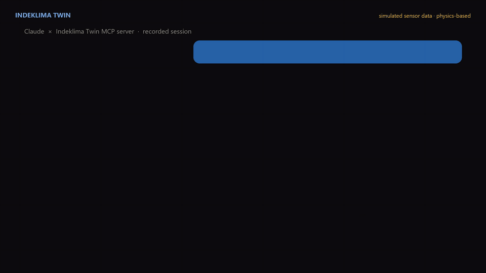</p>

The GIF is a real recorded session ([`results/mcp_claude_demo_full.json`](results/mcp_claude_demo_full.json)).
Claude called `building_overview` → `list_findings` → `list_rooms` → `room_promise`, separated the real breach
from the drifting sensor, proposed an order of work, and flagged on its own that the data is simulated.

```json
{"mcpServers": {"indeklima-twin": {"command": "python", "args": ["<repo>/src/mcp_server.py"]}}}
```

SQL runs on an in-memory copy with external access disabled and configuration locked. `tests/test_mcp.py` drives
every tool through the official MCP client and checks that writes and file reads are refused.

## Write-back: nothing new to learn

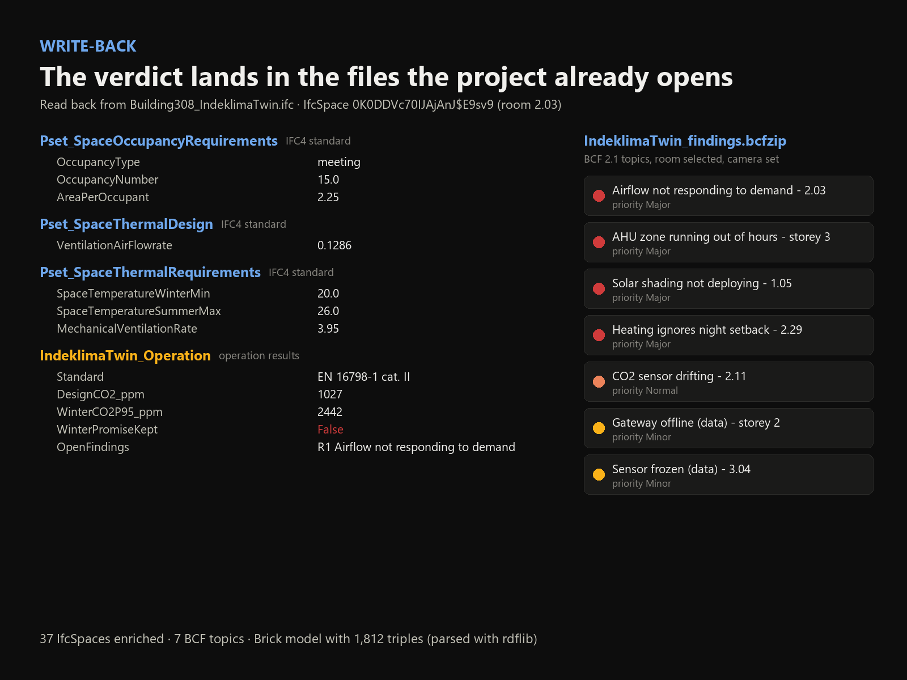

| Output | What's in it | Opens in |
|---|---|---|
| **IFC4** | design intent on every monitored space in standard property sets (`Pset_SpaceOccupancyRequirements`, `Pset_SpaceThermalRequirements`, `Pset_SpaceThermalDesign`) plus an `IndeklimaTwin_Operation` set | Solibri, BIMcollab, Dalux, Revit, Archicad, Bonsai |
| **BCF 2.1** | one issue per finding, room selected, camera set, evidence in the description | Solibri, BIMcollab, Revit, Archicad, Dalux |
| **Brick** | rooms, VAVs, AHU zones and sensor points, each tied to its MQTT topic and IFC GlobalId | BMS / IoT platforms that speak Brick |

## Proof

The detectors never see the simulator's truth.

| Check | Result |
|---|---|
| Planted faults (5 building/sensor + 2 data) | **7/7 found, 0 false alarms, on 16 of 16 runs**, including 5 held-out seeds never used while designing the rules |
| Fault-free building (negative control) | **0 findings** |
| Airflow from CO₂ decay vs truth | **median error 9.9 %**, P90 21.5 %, bias −6.6 % (372 windows) |
| Write-back | 37/37 spaces re-open with their property sets; BCF parses; Brick 1,812 triples parse (rdflib) |
| MCP server | 7 tools through the official client; SQL sandbox refuses writes and file access |
| Tests | 12/12 passing (`pytest tests`) |

Two detectors failed during validation and were fixed for physical reasons, not by tuning thresholds. The shading
rule moved from peak temperature (the VAV hid the fault by cooling harder) to an inverse energy balance. The setback
rule moved from "warmer than the setpoint" (heavy rooms stay warm overnight) to "warmer than the other rooms on the
same night".

## Where it fits

| Tool | When | Question it answers |
|---|---|---|
| IDA ICE, EnergyPlus, BSim | Design | Will this design work? |
| BMS alarms, IoT dashboards | Operation | Is CO₂ above a fixed threshold right now? |
| Digital-twin platforms | Operation | Where is each sensor in the model? |
| **Indeklima Twin** | **Operation** | **Does each room still do what its own design promised, and if not, why?** |

Simulation tools predict the promise. This checks whether it's kept. See [docs/POSITIONING.md](docs/POSITIONING.md)
for the full comparison and the honest gaps.

## Run it

```bash
pip install -r requirements.txt
# config/local_paths.json -> {"source_ifc": "<path to your IFC>"}   (see config/local_paths.example.json)
python src/ifc_extract.py        # IFC -> data/rooms.json + web/building.glb
python src/simulate.py           # synthetic feed; skip it and drop a real feed in data/raw/*.jsonl
python src/run_all.py            # ingest -> QC -> comfort -> CO2-decay airflow -> diagnosis -> results/
python src/validate_ach.py && python src/export_web.py && python src/twin/writeback.py
python -m pytest tests           # acceptance + MCP tests
python src/robustness.py         # 16-seed validation incl. held-out seeds
python src/mcp_server.py         # MCP server over stdio
```

`data/rooms.json` (the room registry extracted from the IFC) ships with the repo, so everything after the first
step runs without the source model.

## Repository

```
src/             pipeline: IFC extract, simulator, ingest, QC, comfort, ventilation, diagnosis, write-back, MCP server
src/twin/        the analysis package (runs unchanged on real data)
tests/           acceptance tests + end-to-end MCP test
web/             3D dashboard (Three.js) and its data
docs/            GitHub Pages site, media, positioning, case study
results/         validation outputs (robustness, airflow, findings, MCP session)
reports/         PDF report
```

<sub>Geometry: IFC4 renovation design model of Building 308. Design airflows: DS/EN 16798-1 cat. II (0.7 L/s·m² + 7 L/s·person). Weather: Copenhagen-Kastrup TMYx (climate.onebuilding.org). Sensor data are simulated.</sub>
